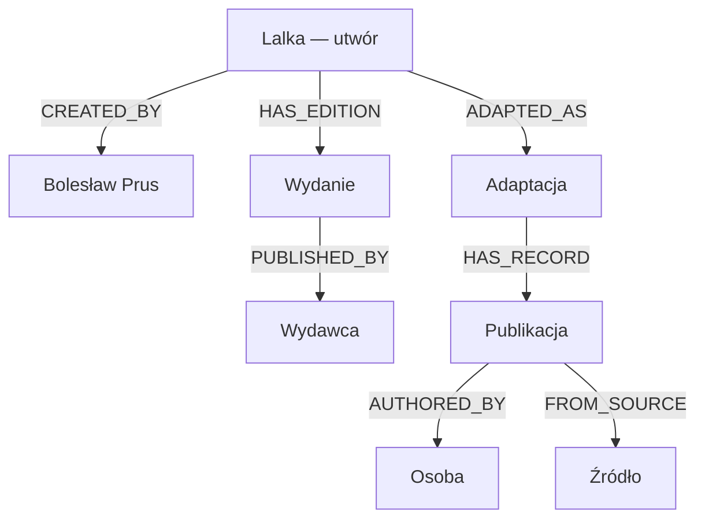
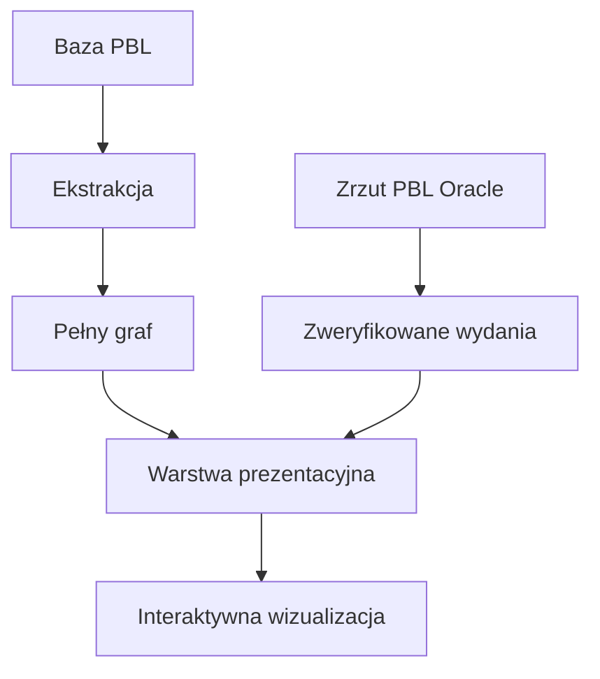

# Lalka Knowledge Graph

**Lalka Knowledge Graph** to eksperymentalny projekt pokazujący, jak rekordy [Polskiej Bibliografii Literackiej (PBL)](https://pbl.ibl.poznan.pl/) można przekształcić w graf relacji między utworem, jego twórcą, adaptacjami ekranowymi, publikacjami, osobami, wydawcami i źródłami bibliograficznymi.

Projekt wykorzystuje „Lalkę” Bolesława Prusa jako studium przypadku. Jego wynikiem jest pełniejszy graf zachowujący strukturę danych PBL, uproszczona warstwa prezentacyjna oraz interaktywna wizualizacja.

## Interaktywna wizualizacja

**[Otwórz Lalka Knowledge Graph](https://polskabibliografialiteracka.github.io/lalka-knowledge-graph/)**

Wizualizacja została przygotowana do przeglądania w przeglądarce i udostępniona za pomocą GitHub Pages. Zawiera osobny widok 55 zweryfikowanych rekordów wydań „Lalki”, które można grupować chronologicznie albo według wydawcy, a także pozwala sprawdzać relacje i podstawowe informacje o rekordach. Przekłady są oznaczone przerywanym obramowaniem, a oś czasu pokazuje także lata bez wydań.

## Co przedstawia graf?

Punktem centralnym grafu jest „Lalka” jako utwór literacki. Z utworem powiązane są:

- Bolesław Prus jako jego twórca;
- osiem ręcznie zweryfikowanych adaptacji: film, serial telewizyjny, pięć audycji radiowych i spektakl teatralny;
- publikacje i inne rekordy bibliograficzne związane z utworem lub adaptacjami, w tym recenzje książek o „Lalce”;
- osoby odpowiedzialne za publikacje;
- wydawcy;
- czasopisma i inne źródła bibliograficzne.

Warstwa prezentacyjna obejmuje obecnie:

| Typ obiektu | Liczba |
|---|---:|
| Utwór | 1 |
| Adaptacje | 8 |
| Wydania (rekordy PBL) | 55 |
| Publikacje | 127 |
| Osoby | 95 |
| Źródła | 81 |
| Wydawcy | 48 |
| **Wszystkie węzły** | **415** |
| **Relacje** | **505** |

Liczby pochodzą z metadanych zapisanych w pliku `data/lalka_presentation_graph.json`. Spośród 55 rekordów wydań 16 to przekłady, a trzy rekordy opisują tomy jednej edycji (53 edycje).

## Cel projektu

Projekt służy sprawdzeniu, jak dane bibliograficzne zapisane pierwotnie jako rekordy i hierarchie można przedstawić jako sieć obiektów i relacji.

Graf pozwala zadawać pytania inne niż podczas przeglądania pojedynczego rekordu, na przykład:

- jakie obiekty są powiązane z „Lalką”;
- jakie adaptacje ekranowe zostały zarejestrowane w PBL;
- jakie publikacje dotyczą konkretnej adaptacji;
- kto jest autorem danej publikacji;
- w jakim źródle została ona odnotowana.

Projekt nie zastępuje modelu danych ani interfejsu PBL. Jest eksperymentem dotyczącym alternatywnego sposobu przetwarzania, modelowania i prezentowania danych bibliograficznych.

## Model grafu

Warstwa prezentacyjna wykorzystuje następujące typy węzłów:

| Typ | Znaczenie |
|---|---|
| `Work` | utwór literacki |
| `Person` | twórca utworu lub osoba związana z publikacją |
| `Adaptation` | adaptacja (film, serial, audycja radiowa, spektakl) |
| `Edition` | zweryfikowane wydanie książkowe utworu |
| `Publication` | publikacja lub inny rekord bibliograficzny |
| `Event` | wydarzenie |
| `Publisher` | wydawca |
| `Source` | czasopismo lub inne źródło bibliograficzne |

Najważniejsze relacje:

| Relacja | Znaczenie |
|---|---|
| `CREATED_BY` | utwór został stworzony przez osobę |
| `ADAPTED_AS` | utwór został zaadaptowany |
| `HAS_EDITION` | utwór ma zweryfikowane wydanie |
| `HAS_RECORD` | adaptacja lub rekord ma powiązany rekord bibliograficzny |
| `REVIEWS` | recenzja dotyczy rekordu (np. książki o „Lalce”) |
| `RELATED_TO` | rekord bibliograficzny jest związany z utworem |
| `AUTHORED_BY` | publikacja ma autora |
| `PUBLISHED_BY` | publikacja została wydana przez wydawcę |
| `FROM_SOURCE` | rekord pochodzi ze wskazanego źródła |



Diagram przedstawia fragment modelu. Publikacje mogą być również bezpośrednio powiązane z utworem relacją `RELATED_TO` oraz z wydawcą relacją `PUBLISHED_BY`.

## Warstwy danych

Projekt rozdziela dane wyodrębnione z PBL od modelu przeznaczonego dla użytkownika:



- `data/lalka_graph.json` zachowuje techniczne typy obiektów i relacje wynikające ze struktury danych PBL;
- `data/lalka_editions_verified.json` przechowuje 55 indywidualnie zatwierdzonych wydań pozyskanych ze zrzutu Oracle;
- `data/lalka_presentation_graph.json` upraszcza ten model na potrzeby wizualizacji;
- `data/lalka_reception_candidates.json` zawiera niezweryfikowanych kandydatów do recepcji „Lalki” spoza hasła utworu;
- `docs/index.html` zawiera opublikowaną wersję interaktywnego grafu.

Relacja `CHILD_OF`, wykorzystywana w PBL do zapisu hierarchii rekordów, pozostaje w pełnym grafie. W warstwie prezentacyjnej jest zastępowana relacjami łatwiejszymi do interpretacji przez użytkownika.

W pełnym grafie powiązanie rekordu z twórcą (`PBL_ZAPISY_TWORCY`) jest relacją `CREATED_BY` tylko dla rekordów rodzaju „utwór”. Pozostałe rekordy otrzymują relację `FILED_UNDER`: oznacza ona, że rekord znajduje się w haśle osobowym twórcy, a nie że twórca jest jego autorem. Autorstwo publikacji opisuje relacja `AUTHOR_OF`.

Niektóre relacje zostały zweryfikowane i dodane ręcznie, ponieważ nie można było ich wiarygodnie odtworzyć wyłącznie na podstawie hierarchii rekordów: adaptacje (PBL zapisuje je w haśle twórcy, a nie utworu), grupy tomów jednej edycji oraz aliasy wydawców występujących w PBL pod kilkoma identyfikatorami. Wszystkie te decyzje są zapisane w `manual_relationships` w metadanych warstwy prezentacyjnej.

Ten sam tekst zapisany w PBL w kilku hasłach (np. artykuł o obu adaptacjach) jest w warstwie prezentacyjnej jednym węzłem. Identyfikatory scalonych rekordów zachowuje pole `merged_pbl_ids`.

## Zakres i ograniczenia danych

Graf przedstawia określony wycinek PBL, a nie pełną bibliografię „Lalki”. Zakres ekstrakcji został wyznaczony przez:

- rekord utworu „Lalka” o identyfikatorze PBL `109715`;
- rekordy, w których występuje Bolesław Prus jako twórca (PBL `3426`) lub autor (PBL `1082`); wybór następuje według identyfikatorów, a dopasowanie po nazwisku służy tylko do kontroli homonimów;
- adaptacje ekranowe o identyfikatorach `304249` i `136679`;
- ustaloną liczbę poziomów hierarchii pobieranych dla poszczególnych grup rekordów.

Zbiór 55 wydań obejmuje rekordy typu `KS` powiązane z Bolesławem Prusem (PBL `3426`), wybrane regułami tytułowymi i następnie zweryfikowane redakcyjnie. Nie powinien być traktowany jako kompletny wykaz wszystkich historycznych wydań „Lalki”; przedstawia zakres obecny w zrzucie PBL i objęty przyjętą procedurą selekcji. Lata 1988–2012 odpowiadają zasięgowi PBL, a nie pełnej historii wydań.

Zbiór zawiera zarówno wydania polskie, jak i przekłady (`is_translation`), a w niektórych przypadkach osobne rekordy kolejnych tomów jednej edycji (`edition_group`).

Wartość `ZA_JEZYK_ORYGINALU` jest w warstwie prezentacyjnej zapisana jako `za_jezyk_oryginalu_raw`. W danych zachowuje się niekonsekwentnie (np. `rus` dla przekładu rosyjskiego), dlatego nie jest interpretowana ani jako język oryginału, ani jako język wydania.

Warstwa prezentacyjna obejmuje rekordy podpięte w PBL pod hasło utworu i adaptacji (do dwóch poziomów hierarchii) oraz ręcznie zweryfikowane adaptacje. Wiele publikacji i wydarzeń dotyczących „Lalki” PBL zapisuje jednak w haśle osobowym Prusa. Nie są one automatycznie łączone z utworem; skrypt `list_reception_candidates.py` wypisuje je do przeglądu redakcyjnego w pliku `data/lalka_reception_candidates.json`.

Podstawowy korpus wyodrębniono 28 sierpnia 2026 roku. Wydania przygotowano dodatkowo na podstawie zrzutu `pbl_snapshot_2026-09-14_13-32-53` utworzonego przez repozytorium `PBL-oracle-export`. Liczebność zbiorów wejściowych i parametry podstawowej ekstrakcji zapisano w `data/lalka_extraction_metadata.json`, a proweniencję wydań w `data/lalka_editions_verified.json`.

## Struktura repozytorium

```text
lalka-knowledge-graph/
├── assets/
│   └── pbl-logo.png
├── data/
│   ├── lalka_records_raw.json
│   ├── lalka_authors_raw.json
│   ├── lalka_creators_raw.json
│   ├── lalka_publishers_raw.json
│   ├── lalka_extraction_metadata.json
│   ├── lalka_editions_verified.json
│   ├── lalka_graph.json
│   ├── lalka_presentation_graph.json
│   └── lalka_reception_candidates.json
├── docs/
│   └── index.html
├── scripts/
│   ├── extract_lalka.py
│   ├── prepare_verified_editions.py
│   ├── inspect_lalka_data.py
│   ├── build_graph.py
│   ├── inspect_graph.py
│   ├── build_presentation_graph.py
│   ├── inspect_presentation_graph.py
│   ├── list_reception_candidates.py
│   └── visualize_graph.py
├── .github/
│   └── workflows/
│       └── reproducibility.yml
├── .gitignore
├── requirements.txt
└── README.md
```

## Przetwarzanie danych

Skrypty należy uruchamiać z głównego katalogu projektu. Zależności:

```bash
pip install -r requirements.txt
```

### 1. Ekstrakcja danych z PBL

```bash
python scripts/extract_lalka.py
```

Ten etap wymaga dostępu do bazy Oracle PBL oraz skonfigurowania zmiennych środowiskowych:

```text
PBL_ORACLE_HOST
PBL_ORACLE_PORT
PBL_ORACLE_SERVICE
PBL_ORACLE_USER
PBL_ORACLE_PASSWORD
PBL_ORACLE_LIB_DIR
```

Dane dostępowe nie są przechowywane w repozytorium. Osoby bez dostępu do bazy mogą korzystać z plików JSON zapisanych w katalogu `data` i rozpocząć pracę od budowy grafu.

### 2. Inspekcja danych wejściowych

```bash
python scripts/inspect_lalka_data.py
```

### 3. Budowa i kontrola pełnego grafu

```bash
python scripts/build_graph.py
python scripts/inspect_graph.py
```

### 4. Budowa i kontrola warstwy prezentacyjnej

Plik zweryfikowanych wydań jest wersjonowany w repozytorium. Można go odtworzyć ze zrzutu przygotowanego przez `PBL-oracle-export` i pliku kandydatów po przeglądzie redakcyjnym. Kandydat może mieć pole `decision` (`approved` lub `rejected`) i uzasadnienie w `user_notes`; odrzucone rekordy trafiają do sekcji `rejected`. Opcja `--approve-all` zatwierdza kandydatów bez jawnej decyzji:

```bash
python scripts/prepare_verified_editions.py \
  --snapshot-dir /ścieżka/do/zrzutu \
  --snapshot-name pbl_snapshot_2026-09-14_13-32-53 \
  --candidates /ścieżka/do/lalka_candidates.json \
  --approve-all
```

Następnie:

```bash
python scripts/build_presentation_graph.py
python scripts/inspect_presentation_graph.py
python scripts/list_reception_candidates.py
```

Budowa warstwy prezentacyjnej porównuje wydania ze zrzutu Oracle z pełnym grafem (tytuły, lata, wydawcy) i zapisuje wynik w `snapshot_consistency`.

### 5. Generowanie wizualizacji

```bash
python scripts/visualize_graph.py
```

Skrypt wykorzystuje dane z `data/lalka_presentation_graph.json` i tworzy interaktywny plik `docs/index.html` (biblioteka vis-network ładowana z CDN). Plik nie powinien być edytowany ręcznie.

### 6. Kontrola odtwarzalności

Po etapach 3–5 pliki w `data` i `docs` muszą być identyczne z wersją w repozytorium:

```bash
git diff --exit-code -- data docs
```

Tę samą kontrolę wykonuje GitHub Actions (`.github/workflows/reproducibility.yml`).

Projekt wykorzystuje Python, SQL, JSON, Oracle Database, pandas, Beautiful Soup, vis-network oraz HTML/JavaScript.

## Źródło danych

Źródłem danych jest [Polska Bibliografia Literacka](https://pbl.ibl.poznan.pl/), prowadzona przez Pracownię Bibliografii Bieżącej Instytutu Badań Literackich PAN.

Dane PBL nie są modyfikowane w bazie źródłowej. Projekt przetwarza ich wyodrębnioną kopię do kolejnych warstw przeznaczonych do analizy i wizualizacji.

## Status projektu

Projekt znajduje się w fazie eksperymentalnej i jest rozwijany iteracyjnie. Model grafu, zakres danych oraz sposób wizualizacji mogą się zmieniać wraz z kolejnymi etapami prac.
